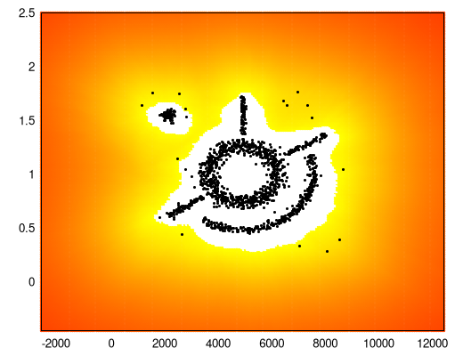
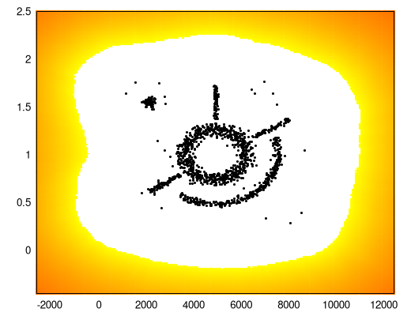
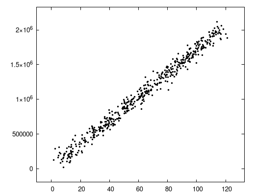
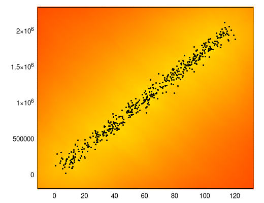
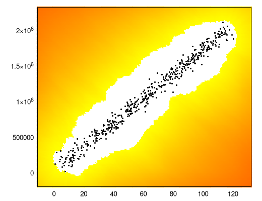

# GEIF: Geometric Extended Isolation Forest — Algorithmic Specification

**Author / Maintainer:** Timo Savinen (AI-assisted)  
**Repository:** [github.com/TimoSavi/geif](https://github.com/TimoSavi/geif)

---

## 1. Introduction & Theoretical Motivation

### 1.1 The Isolation Forest Paradigm
The Isolation Forest family isolates anomalous observations rather than profiling normal points:
1. **Isolation Forest (iForest)**: Partitions space using axis-aligned orthogonal cuts. Suffers from severe axis-aligned artifacts, blind spots, and artificial rectangular halos.
2. **Extended Isolation Forest (EIF)**: Replaces orthogonal cuts with linear hyperplanes with normal vectors drawn from an isotropic standard Gaussian $n \sim \mathcal{N}(0, I)$.
3. **Geometric Extended Isolation Forest (GEIF)**: Modernizes isolation into a modular, multi-algorithm geometric framework featuring hyperspherical cavity-carving trees, Voronoi bisector hyperplanes, exemplar kernel density estimation, and continuous metric depth with universal scale calibration.

### 1.2 Theoretical Challenges in Space Partitioning
Unconstrained spatial partitioning algorithms encounter four fundamental mathematical pitfalls:
1. **The Infinite Hyperplane Paradox**: Linear hyperplanes extend to $\pm\infty$. A cut separating two local points inside a cluster continues infinitely, arbitrarily slicing empty outer space millions of units away and creating irregular "starburst rays".
2. **The Density Bias**: Discrete path lengths (integer edge hop counts) measure sample count rather than spatial density. A tight cluster of 50 samples isolates in $\approx \log_2(50) \approx 5.6$ hops, while a diffuse cloud of 500 samples isolates in $\approx \log_2(500) \approx 9$ hops.
3. **Disparate Feature Scales**: When features represent disparate physical units (e.g. microseconds vs. bytes, or coordinates spanning $[1000, 9000]$ vs. $[0.2, 1.8]$), unscaled distance metrics collapse into 1D axis projections.
4. **Topological Blindness**: Linear hyperplanes cannot carve non-convex internal cavities (such as concentric rings or donut hollows) without slicing across empty interior space.

### 1.3 The GEIF Architecture
**GEIF (Geometric Extended Isolation Forest)** resolves these challenges through a modular multi-algorithm engine built upon robust, unified foundational primitives:
- **Pluggable Spatial Engines**: Selectable via `-B, --algo` (`exemplar` default, `bubble`, `voronoi`, `ceif`).
- **Hyperspherical Cavity Carving**: The **Bubble** algorithm bounds clusters in compact hyperspherical shells, isolating interior cavities into empty void leaves.
- **Universal Scale Calibration ("Zero Kelvin")**: Theoretical deepest-leaf calibration ensures dense cluster centroids reach the physical inlier floor ($s \to 0.0$).
- **Asymptotic Outer Space Continuum**: Outer space distance decays smoothly towards $1.0$ without boundary saturation artifacts.
- **Normalized Scale Invariance**: Regularized dimension span weighting eliminates aspect ratio distortions across $5000:1$ spans.

---

## 2. Common Foundational Methods Across All Engines

All algorithm engines in GEIF share a unified set of mathematical primitives and calibration methods.

### 2.1 Universal Scale Calibration ("Zero Kelvin")

In traditional isolation forests, raw anomaly scores depend heavily on sample count and tree depth, causing the minimum score of normal inliers to fluctuate between $0.35$ and $0.85$ across different geometries.

GEIF eliminates post-hoc score scaling by calculating the theoretical deepest-leaf traversal:

1. During model initialization, each tree in the ensemble is traversed along its deepest branch to compute the theoretical maximum metric depth $H_{\text{deepest}}$.
2. The forest-wide maximum theoretical depth is established:

$$
H_{\text{train,max}} = \frac{1}{T} \sum_{t=1}^T H_{\text{deepest}}^{(t)}
$$

3. A calibrated universal scale factor is applied:

$$
H_{\text{max}} = \kappa \cdot H_{\text{train,max}} \quad (\kappa = 1.15)
$$

4. The raw anomaly score is calculated directly from accumulated continuous metric depth $H(x)$:

$$
s_{\text{raw}}(x) = \exp\left(-\frac{H(x)}{c(\psi)}\right)
$$

5. The calibrated score is mapped across the theoretical span from $s_{\min}$ to $s_{\max}$:

$$
s(x) = \frac{s_{\text{raw}}(x) - s_{\min}}{s_{\max} - s_{\min}}
$$

where:

$$
s_{\min} = \exp\left(-\frac{H_{\text{max}}}{c(\psi)}\right)
$$

represents the "Zero Kelvin" deepest inlier floor, and $s_{\max} = 1.0$.

**Guaranteed Inlier Floor**: Dense cluster centroids naturally achieve scores near $0.00$, establishing $T = 0.50$ as a universal, calibrated default threshold across all datasets.

---

### 2.2 Non-Reachable 1.0 (Asymptotic Bounding & Stadium Metric)

In unbounded Euclidean space, distance to training data $d \to \infty$ should indicate maximum anomaly. However, truncating scores abruptly at $1.0$ creates artificial boundary walls.

GEIF enforces asymptotic exponential outer space attenuation:

$$
s_{\text{final}}(x) = 1.0 - (1.0 - s_{\text{tree}}(x)) \cdot \exp(-\lambda \cdot d_{\text{out}}(x))
$$

where $\lambda = 0.10$ and $d_{\text{out}}(x)$ is the normalized Euclidean distance to the ensemble training envelope bounding box:

$$
d_{\text{out}}(x) = \sqrt{\sum_{j=1}^D \left(\frac{\max(0, \min_j - x_j, x_j - \max_j)}{\text{span}_j}\right)^2}
$$

#### Properties:
1. **Strict Upper Bound**: For all finite $x \in \mathbb{R}^D$, $s_{\text{final}}(x) < 1.0$. The score asymptotically approaches $1.0$ as $d_{\text{out}} \to \infty$.
2. **Smooth Gradient**: Outer space produces rounded, convex equi-distance shells ("stadium metric") without starburst rays.
3. **No Numerical Overflow**: Floating-point values remain strictly within $[0.0, 1.0)$.

| Wide Area Evaluation ($T = 0.50$) | Deep Outer Space Perimeter ($T = 0.85$) |
|:---:|:---:|
|  |  |

---

### 2.3 Dynamic Dimensional Leaf Sizing & Nearest Neighbor Bounding

In earlier Isolation Forest variants, node partitioning stopped at an arbitrary hardcoded sample threshold (e.g. $N_{\text{leaf}} < 3$). GEIF introduces a dimension-dependent minimum leaf sample count with a **1D stabilization floor** of 4 samples (`GEIF_MIN_LEAF_SAMPLE_FLOOR = 4U`):

$$
N_{\text{min-leaf}}(D) = \max\left(4, \min\left(2^D, 8\right)\right) = \begin{cases} 4 & \text{if } D \le 2 \\ 8 & \text{if } D \ge 3 \end{cases}
$$

**Geometric & Algorithmic Rationale:**
- **$D = 1$ ($4$ samples, 1D stabilization floor):** While a 1D point is theoretically bounded by 2 bilateral samples (left and right), isolating down to 2 samples in 1D creates excessive variance, boundary spikes/valleys, and brittle relative distance estimation near distribution edges. Enforcing a floor of 4 samples (`GEIF_MIN_LEAF_SAMPLE_FLOOR = 4U`) provides robust bilateral framing (both immediate and secondary neighbors), stabilizes the relative leaf distance calculation $d_{\text{rel}}(x)$, and prevents anomalous distortion under quantile thresholding (e.g. `-O 80%`).
- **$D = 2$ ($2^2 = 4$ samples):** An interior 2D query point is framed across all four quadrants ($++$, $+-$, $-+$, $--$). Leaves with 4 samples ensure query points can be completely surrounded on all sides.
- **$D = 3$ ($2^3 = 8$ samples):** Provides samples across all 8 spatial octants.
- **Dimension Cap at $D \ge 3$ / High-D Ceiling ($8$ samples):** Capping at 8 samples (`GEIF_MIN_LEAF_SAMPLE_HIGH_DIM = 8U`) prevents exponential leaf starvation for higher dimensions (where $2^{10} = 1024$ would exceed the sub-sample size $\psi = 256$), ensuring isolation trees maintain healthy split depth and balanced partitioning across high-dimensional feature spaces.

In C17 (`include/geif/types.h`), this dynamic leaf termination is implemented as:
```c
#define GEIF_MIN_LEAF_SAMPLE_FLOOR     4U       /**< Floor on minimum leaf samples / nearest neighbors (1D stabilization) */
#define MIN_LEAF_FLOOR_SAMPLES         GEIF_MIN_LEAF_SAMPLE_FLOOR
#define GEIF_MIN_LEAF_SAMPLE_DIM_CAP   4U       /**< Dimensionality threshold (D < 4) for 2^D minimum leaf samples */
#define GEIF_MIN_LEAF_SAMPLE_HIGH_DIM  8U       /**< Fixed minimum leaf sample count for D >= 4 */
#define GEIF_NODE_MIN_SAMPLE(d)        (((1U << (d)) < GEIF_MIN_LEAF_SAMPLE_FLOOR) ? GEIF_MIN_LEAF_SAMPLE_FLOOR : (((d) < GEIF_MIN_LEAF_SAMPLE_DIM_CAP) ? (1U << (d)) : GEIF_MIN_LEAF_SAMPLE_HIGH_DIM))
#define NODE_MIN_SAMPLE(d)             GEIF_NODE_MIN_SAMPLE(d)
```

**Computational Advantage:**  
By avoiding excessive fine splits down to 1–3 sample leaves, trees remain shallower by 1–2 levels, cutting node allocations and tree construction time. Fine-grained local density resolution is naturally shifted to the continuous Euclidean relative distance evaluation ($d_{\text{rel}}(x)$), eliminating artificial hyperplane slicing artifacts and sharply carving out interior topological cavities (such as donut holes).

To evaluate local cluster density and detect interior voids without constructing an expensive global $k$-d tree, GEIF computes leaf relative distances using a bounding-box projection:

For a test point $x$ falling into a leaf node:
1. The leaf identifies the bounding hyper-rectangle formed by its bounding data points.
2. In $D$-dimensional space, the distance to the nearest bounding samples is evaluated. The maximum nearest neighbors $K$ evaluated in a leaf also enforces the same 1D stabilization floor:

$$
K_{\text{nearest}}(D) = \max\left(4, \min\left(2^D, 32\right)\right) = \begin{cases} 4 & \text{if } D \le 2 \\ 2^D & \text{if } 3 \le D \le 4 \\ 32 & \text{if } D \ge 5 \end{cases}
$$

$$
d_{\text{rel}}(x) = \frac{1}{K} \sum_{k=1}^K \frac{\Vert x - p_k \Vert_{\text{scaled}}}{\delta_{\text{nominal}}}
$$

3. When $x$ is well-centered among the leaf samples, $d_{\text{rel}}(x) \approx 0$, preserving full metric depth.
4. When $x$ lies in an empty void or cavity, $d_{\text{rel}}(x) \gg 1$, triggering Cauchy-Lorentz residual cell damping:

$$
H_{\text{attenuated}}(x) = H_{\text{tree}}(x) \cdot \frac{1}{1 + \left(d_{\text{rel}}(x)\right)^2}
$$

This attenuates depth in hollow interior regions, elevating their anomaly scores to outlier levels without external $k$-NN searches.

---

### 2.4 Dimension Span Regularization & Extreme Aspect Ratio Invariance (5000:1 Disparity)

When features possess disparate physical units (e.g., milliseconds vs. packet bytes, or coordinates spanning $[1000, 9000]$ vs. $[0.2, 1.8]$ in `complex2d.csv` and $[5, 120]$ vs. $[10^5, 2 \times 10^6]$ in `Wtest.csv`), naive Euclidean distance degenerates into 1D vertical slicing.

GEIF natively enforces scale invariance across extreme aspect ratios ($5000:1$ disparity) by evaluating normalized squared Euclidean distances weighted by regularized feature spans:

$$
\text{span}_j = \max_{x \in X} x_j - \min_{x \in X} x_j
$$

- If $\text{span}_j \le 10^{-9}$ (zero-variance / constant feature), $\text{span}_j$ is set to $1.0$ and dimension health masking assigns zero weight during distance calculations.
- All spatial distance calculations evaluate normalized coordinates:

$$
\Vert x - y \Vert_{\text{scaled}}^2 = \sum_{j=1}^D \left(\frac{x_j - y_j}{\text{span}_j}\right)^2
$$

Because all dimensions contribute isotropically to the radial partitioning, splitting spheres naturally conform to the true cluster shape regardless of numerical magnitude.

| Metric | `Wtest.csv` (Span: $X \approx 110, Y \approx 1,900,000$) |
|:---|:---:|
| **Raw Training Samples** |  |
| **$T = 0.00$ (Continuous Landscape)** |  |
| **$T = 0.50$ (Inlier Envelope)** |  |

**Result**: The narrow diagonal linear band is cleanly enveloped with zero axis distortion and zero configuration overhead.

---

### 2.5 Streaming Reservoir Pool & Model Adaptivity

GEIF ingests streaming data using Algorithm R reservoir sampling:
- Maintains an active reservoir pool of size $N_{\text{pool}} = T \times \psi$ per sub-forest.
- As new training rows arrive, samples are accepted with probability $\psi / N_{\text{seen}}$.
- **Adaptivity Ceiling**: Caps historical extra rows at $3 \times \psi$, ensuring continuous adaptivity to population drift without unbounded memory growth.
- **Sparse Serialization**: Saves the compact reservoir pool to JSON (`< 5 KB`), enabling fast tree re-building upon load in $< 5\text{ ms}$.

---

## 3. Algorithm 1: Hyperspherical Bubble Trees (`bubble`)

### 3.1 Motivation & Concept
Linear hyperplanes inherently cut through the center of ring and hollow distributions. The **Bubble** algorithm replaces infinite linear cuts with hyperspherical cavity-carving nodes:

$$
\mathcal{B}(c, R) = (x \in \mathbb{R}^D : \Vert x - c \Vert_{\text{scaled}}^2 \le R^2)
$$

```
               [Hypersphere Node B(c, R)]
                      /          \
                     /            \
       Inside: ||x - c||^2 <= R^2   Outside: ||x - c||^2 > R^2
                   /                \
        [Sub-cluster Node]      [Void / Outer Leaf]
```

### 3.2 Mathematical Formulation

#### Variable & Set Definitions
- **Sample Subset $S_v$**: The active subset of sample observations reaching tree node $v$ during recursive partitioning. At the tree root, $S_{\text{root}} = S$ where $|S| = \psi$ (the sub-sample size, default $\psi = 256$, drawn without replacement from the streaming reservoir pool). Node $v$ partitions $S_v$ into an interior subset and an exterior subset:
  - Interior subset: $S_{v,\text{in}} = (x \in S_v : \text{dist}^2(x, c) \le R^2)$
  - Exterior subset: $S_{v,\text{out}} = (x \in S_v : \text{dist}^2(x, c) > R^2)$
- **Feature Coordinate Span $\text{span}_j$**: The bounding coordinate span along feature dimension $j \in \{1, \ldots, D\}$ evaluated across all training observations:

$$
\text{span}_j = \max_{x \in X} x_j - \min_{x \in X} x_j
$$

If $\text{span}_j \le 10^{-9}$ (zero-variance or constant feature), $\text{span}_j$ is set to $1.0$ and dimension health masking deactivates feature dimension $j$ by assigning zero weight during distance calculations.

#### Partitioning Steps
1. **Center Selection**: The center $c \in \mathbb{R}^D$ is placed at the centroid of two randomly drawn distinct samples $A, B \in S_v$:

$$
c = \frac{A + B}{2}
$$

For dimensions $D \le 64$, the center vector is allocated directly on the CPU stack (`stack_center[64]`), avoiding heap allocation.

2. **Normalized Squared Metric**:

$$
\text{dist}^2(x, c) = \sum_{j=1}^D \left(\frac{x_j - c_j}{\text{span}_j}\right)^2
$$

Operating directly on squared distances completely eliminates expensive `sqrt()` operations during tree construction.

3. **Median Cut via $O(N)$ Quickselect**:
The splitting radius $R^2$ is chosen as the median squared distance of all samples in $S_v$ using Hoare selection (`quickselect_median`):

$$
R^2 = \text{median}\left(\text{dist}^2(x_i, c) : x_i \in S_v\right)
$$

4. **In-Place Two-Pointer Partitioning**:
Samples in $S_v$ are partitioned in-place into interior ($S_{v,\text{in}}$) and exterior ($S_{v,\text{out}}$) subsets via a two-pointer swap, eliminating per-node heap allocations.

5. **Empty Void Leaves**:
When a partition region contains no training samples ($|S_v| = 0$, e.g. the hollow interior of a donut), it terminates as an empty void leaf ($N_{\text{leaf}} = 0$) with calibrated residual depth, flagging any query point falling within it as anomalous.

---

## 4. Algorithm 2: Voronoi Hyperplane Bisectors (`voronoi`)

### 4.1 Concept
Rather than drawing random Gaussian normal vectors, the **Voronoi** engine places hyperplanes at the exact perpendicular bisector between two randomly selected samples $A, B \in S_v$:

$$
P_{\text{mid}} = \frac{A + B}{2}, \quad \vec{n} = \frac{B - A}{\Vert B - A \Vert}
$$

### 4.2 Single Dot-Product Inference
The decision rule for query point $x$ simplifies algebraically to a single dot product:

$$
x \cdot \vec{n} < P_{\text{mid}} \cdot \vec{n} \implies \text{Branch Left (closer to } A\text{)}
$$

$$
x \cdot \vec{n} \ge P_{\text{mid}} \cdot \vec{n} \implies \text{Branch Right (closer to } B\text{)}
$$

### 4.3 Key Characteristics
- **Data-Driven Orientation**: Difference vector $B - A$ naturally inherits the orientation and scale of the local cluster.
- **Zero Empty-Space Hyperplanes**: Cuts are always anchored between real observations.
- **Crisp Cluster Separation**: Excels at separating adjacent, linearly separable clusters.

---

## 5. Algorithm 3: Exemplar Kernel Density Estimation (`exemplar`, Default)

### 5.1 Architecture & Exemplar Generation
The **Exemplar** engine is a non-tree spatial kernel estimator operating directly on the active reservoir sample pool. While tree-based methods (`bubble`, `voronoi`, `ceif`) recursively cut the feature space into discrete polyhedral or hyperspherical cells, Exemplar evaluates a regularized, infinitely differentiable ($C^\infty$) continuous density field across the observation domain.

#### How Exemplars Are Generated & Maintained
1. **Streaming Reservoir Ingestion**: Observations arrive via streaming Algorithm R reservoir sampling (or batch training).
2. **Reservoir Pool Sizing ($N$)**: The engine maintains an active reservoir pool of $N$ exemplar vectors:

$$
\{x_1, x_2, \ldots, x_N\} \subset \mathbb{R}^D
$$

where pool size $N = |S_{\text{pool}}|$ is bounded by capacity $N_{\text{capacity}}$ (default $N = \psi = 256$ per sub-forest or category).

3. **Bounded Adaptive Replacement**:
   - When the reservoir is not yet full (total observed rows $n \le N_{\text{capacity}}$), each incoming point is accepted directly into the pool.
   - When the reservoir capacity is reached ($n > N_{\text{capacity}}$), incoming point $x_t$ replaces a randomly selected existing exemplar in the pool with probability:

$$
P(\text{accept}) = \frac{N_{\text{capacity}}}{\min(N_{\text{seen}}, (C + 1) N_{\text{capacity}})}
$$

where $C$ is the adaptive ceiling factor (default $C = 3$). This ceiling cap prevents sample freezing over long streams while guaranteeing continuous adaptivity to distribution drift.

4. **Spatial Anchors**: These $N$ exemplar observations serve as non-parametric kernel centroids. Because no decision trees are grown or traversed, memory overhead is minimal ($< 5\text{ KB}$ per category) and model cold-starts require $< 1\text{ ms}$.

---

### 5.2 Mathematical Formulation
The Exemplar engine evaluates anomaly scores using a simple, unified Cauchy kernel formulation over the $U_{\text{unique}}$ unique exemplar locations $u_i$ (each with duplicate count $c_i \ge 1$) that handles multi-cluster geometries, heavy duplicate distributions, isolated outliers, and identical-sample corner cases without high-end clamping or outer-space splices:

#### 1. Cap-5 $K$-NN Spacing & Low-End Bandwidth Floor ($b_i$)
1. For each unique exemplar location $u_i$ ($i = 1 \ldots U_{\text{unique}}$), duplicate multiplicity is capped at $m_i = \min(c_i, 5)$ during the $K = 5$ nearest-neighbor search (contributing at most $m_i - 1 \le 4$ self-duplicates at distance $0$). Because at most 4 neighbors can lie at distance $0$, the 5th nearest neighbor always comes from a distinct location ($b_i > 0$ whenever $U_{\text{unique}} \ge 2$):

$$
0 \le d_{(1)}(u_i) \le d_{(2)}(u_i) \le \ldots \le d_{(K)}(u_i)
$$

2. The raw local bandwidth $r_i$ is the arithmetic mean of the $K = \min(5, N_{\text{knn}} - 1)$ nearest neighbor distances (where $N_{\text{knn}} = \sum_i m_i$):

$$
r_i = \frac{1}{K} \sum_{k=1}^K d_{(k)}(u_i)
$$

3. Across the capped $K$-NN sample set, the weighted mean $\mu_b$ and standard deviation $s_b$ are computed:

$$
\mu_b = \frac{1}{N_{\text{knn}}} \sum_{i=1}^{U_{\text{unique}}} m_i r_i, \qquad s_b = \sqrt{\frac{1}{N_{\text{knn}}} \sum_{i=1}^{U_{\text{unique}}} m_i (r_i - \mu_b)^2}
$$

4. Each unique location's bandwidth $b_i$ is floored at $b_{\min}$ (**low-end clamping only**; no upper clamp is applied):

$$
b_{\min} = \max\left(0.5 \mu_b, \mu_b - s_b\right), \qquad b_i = \max\left(b_{\min}, r_i\right)
$$

- **Why High-End Clamping Is Omitted**: Because the unified kernel peak scales as $\sqrt{c_i} / b_i$ at $x = u_i$, an isolated outlier far from the inlier clusters naturally receives a large $b_i$ and negligible self-density ($1 / b_i \to 0$). It cannot form a false inlier halo on its own, yet if real population drift later accumulates $\ge 6$ samples in that region, their local $b_i$ shrinks and they organically form a new inlier cluster without needing `-k` outlier deletion.
- **Identical-Samples Corner Case ($\mu_b = 0$)**: When all samples in the dataset are identical ($U_{\text{unique}} = 1$, so $\mu_b = 0$), coordinate offsets from `min` are preserved and $b_{\min}$ falls back to one-tenth of the mean coordinate magnitude:

$$
b_1 = \max\left(\frac{1}{10 D} \sum_{d=1}^D |u_{1,d}|, 10^{-6}\right)
$$

#### 2. Sublinear Duplicate Growth & Unified Cauchy Kernel Pooling ($D(x)$ and $s(x)$)
Instead of normalizing weights to sum to $1$, inverse-bandwidth credibility ($1 / b_i$), sublinear duplicate scaling ($\sqrt{c_i}$), and the Cauchy kernel $1 / (1 + (d / b_i)^2)$ are combined into a single unified sum over the $U_{\text{unique}}$ unique locations:

$$
D(x) = \sum_{i=1}^{U_{\text{unique}}} \frac{\sqrt{c_i}}{b_i \left(1 + \frac{\Vert x - u_i \Vert_{\text{scaled}}^2}{b_i^2}\right)} = \sum_{i=1}^{U_{\text{unique}}} \frac{\sqrt{c_i} \cdot b_i}{b_i^2 + \Vert x - u_i \Vert_{\text{scaled}}^2}
$$

- **Sublinear Duplicate Growth ($\sqrt{c_i}$)**: Repeated observations at $u_i$ reinforce local density sublinearly via $\sqrt{c_i}$, widening the inlier contour smoothly as duplicate counts grow (e.g., from $c_i = 2$ to $c_i = 14$) without allowing extreme integer duplicate spikes (e.g., hundreds of identical status codes) to linearly blow up $D_{\max}$ and eclipse smaller valid modes.

During training, the peak density across the unique exemplars is calibrated with a 5% headroom factor ($1.05$) above the densest location to establish a near-zero baseline:

$$
D_{\max} = 1.05 \times \max_{1 \le i \le U_{\text{unique}}} D(u_i)
$$

The final anomaly score $s(x) \in [0.0, 1.0)$ applies fractional decay ($p = \text{decay}$, default $0.5$, configurable via `DECAY` in `~/.geifrc` or `-g <rcfile>`) to the normalized density ratio:

$$
s(x) = 1.0 - \left(\min\left(1.0, \frac{D(x)}{D_{\max}}\right)\right)^{\text{decay}}
$$

- **Near-Zero Baseline**: At the densest sample $u_{\text{peak}}$, the ratio $D(u_{\text{peak}})$ to $D_{\max}$ is $1 / 1.05$, yielding $s(u_{\text{peak}}) \approx 0.0241$ (for $\text{decay} = 0.5$).
- **Interior Cavity & Multi-Cluster Sharpness**: Inside the sum, each kernel retains sharp $1 / (b_i^2 + d^2)$ Cauchy localization, preventing points on a surrounding ring from flooding hollow cavities ($s \approx 0.52$).
- **Unified Outer-Space Attenuation & Sensitivity Tuning**: Applying the fractional exponent $\text{decay} = 0.5$ to $D(x) / D_{\max}$ produces a smooth $O(1/d)$ decay to $1.0$ at large distances without requiring a separate outer-stadium bounding-box splice. Setting `DECAY` in `~/.geifrc` tunes outlier strictness globally across existing JSON models without modifying shell scripts (values $> 0.5$ increase score sensitivity/strictness; values $< 0.5$ make outlier detection looser).

---

### 5.3 Contiguous SIMD Acceleration & Complexity
- **Inference Complexity**: $O(D \cdot N)$ where $N = 256$ is small and fixed.
- **Straight-Line SIMD Vectorization**: Because exemplar scoring traverses a contiguous coordinate array without conditional branching or tree pointer indirection, AVX2 / FMA vector pipelines evaluate 8 doubles per instruction, reaching **15.3 million evaluations/sec** on standard x86-64 hardware.
- **Cold-Start Efficiency**: Tree construction time is $0\text{ ms}$; computing $K$-NN bandwidths and credibility weights for $N = 256$ takes $< 1\text{ ms}$.

---

## 6. Algorithm 4: Extended Hyperplane Engine (`ceif`)

### 6.1 Concept
The **CEIF Hyperplane Engine** provides data-anchored isotropic Gaussian cuts combined with continuous metric depth accumulation:
- A sample point $P$ is drawn uniformly from $S_v$ as the intercept anchor.
- A random normal vector $n \sim \mathcal{N}(0, I)$ is generated from standard normal distributions and normalized ($n \leftarrow n / \Vert n \Vert$).
- Continuous depth increments $\Delta H = 1/\delta$ accumulate along the traversal path.
- Deepest-leaf Zero Kelvin calibration maps raw scores to $[0.0, 1.0)$.

### 6.2 Key Characteristics
- Provides continuity and compatibility with classical Extended Isolation Forest benchmarks.
- Well-suited for high-dimensional diffuse Gaussian distributions where linear hyperplanes are mathematically preferred.

---

## 7. Comparative Engine Summary

| Property | Bubble (`bubble`) | Voronoi (`voronoi`) | Exemplar (`exemplar`, Default) | Hyperplane (`ceif`) |
| :--- | :---: | :---: | :---: | :---: |
| **Partition Geometry** | Hyperspheres $\mathcal{B}(c, R)$ | Perpendicular Bisectors | Regularized Cauchy Kernel | Gaussian Hyperplanes |
| **Data Structure** | Binary Tree | Binary Tree | Aligned Sample Array | Binary Tree |
| **Internal Void Detection** | **Exceptional (Void Leaves)** | Moderate (Polyhedral Cuts) | **Exceptional ($s \approx 0.56$)** | Blind (Hyperplane Bridging) |
| **Aspect Ratio Robustness** | **Native (Span-Scaled)** | **Native (Sample Bisector)** | **Native (Span-Scaled)** | Scaled Coordinate Metric |
| **Inference Complexity** | $O(D \log \psi)$ | $O(D \log \psi)$ | $O(D \cdot \psi)$ SIMD Vectorized | $O(D \log \psi)$ |
| **Scoring Throughput** | Very Fast ($\approx 5\text{ M}$ rows/sec) | Fast ($\approx 3\text{ M}$ rows/sec) | **Fastest ($\approx 15.3\text{ M}$ rows/sec)** | Moderate ($\approx 2.4\text{ M}$ rows/sec) |
| **Cold-Start Build Time** | $O(N \log N)$ (Trees built) | $O(N \log N)$ (Trees built) | **Instant ($< 1\text{ ms}$, Zero Trees)** | $O(N \log N)$ (Trees built) |
| **Categorization Accuracy** | 60.14% | 61.51% | **88.53% (Clear Winner)** | 60.11% |

For detailed multi-algorithm selection guidance, empirical heatmaps, drift analysis, categorization benchmarks, and performance profiles, see [**`docs/algorithm_selection.md`**](algorithm_selection.md).
